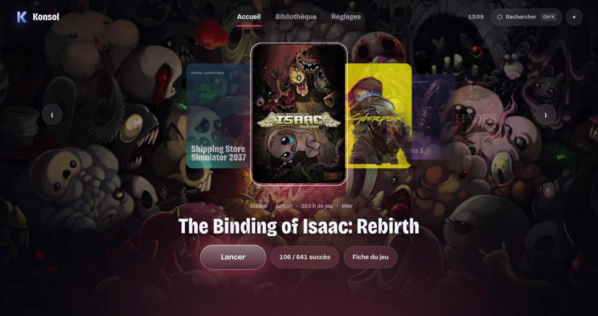
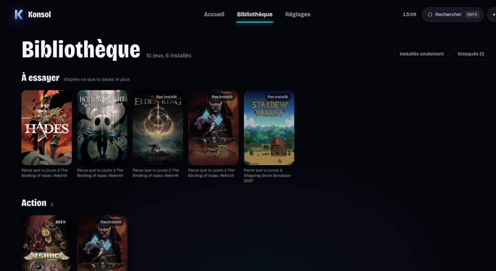
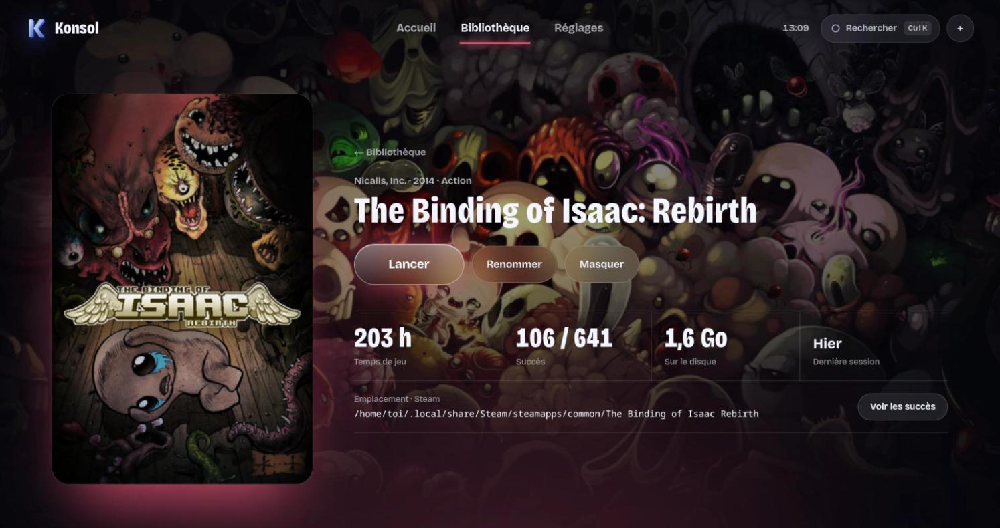

<div align="center">


# Konsol

Tous les jeux du PC au même endroit, lancés sans ouvrir leur launcher.

[](../../releases/latest)
[](../../releases/latest)

<br />



</div>

<br />

J'en avais marre d'ouvrir Steam, Heroic ou un launcher différent à chaque fois que je voulais jouer. Alors j'ai fait Konsol : tous les jeux du PC sont dans une seule fenêtre, tu choisis, tu lances, et le launcher reste caché derrière.

## 🎮 Tous tes jeux, même ceux sans launcher

Konsol va chercher tout seul les jeux Steam, ceux de Heroic (GOG, Epic et Amazon), les jeux qui ont un raccourci dans ton menu et ceux qui traînent dans tes dossiers de jeux, genre un repack installé dans un préfixe Wine ou un recomp natif. Télécharge un nouveau jeu dans `~/Games` et il apparaît quelques secondes plus tard, sans rien faire. Les outils de Steam comme Proton, les logiciels comme Wallpaper Engine et les launchers passent à la trappe.

Sur l'accueil, tes jeux installés défilent en carrousel, du dernier joué au plus ancien. Les flèches `←` et `→` passent d'un jeu à l'autre, `Entrée` ou un double-clic le lance, et `Ctrl K` ouvre la recherche. L'image du jeu prend tout le fond et l'interface prend sa couleur.

> [!TIP]
> Konsol fouille `~/Games` et `~/Jeux` par défaut. Tu changes la liste dans Réglages, Sources, Dossiers de jeux.

## 📚 Toute ta bibliothèque, rangée par genre

L'onglet Bibliothèque montre aussi les jeux que t'as achetés sans les installer, rangés par genre : Action, RPG, Aventure, Simulation… En haut, la rangée À essayer te propose des jeux que t'as à peine lancés et qui ressemblent à ceux où tu passes le plus de temps, avec le jeu qui a fait pencher la balance. Sur un jeu pas installé, le bouton Installer ouvre directement Steam ou Heroic sur la bonne page.

<div align="center">

</div>

> [!NOTE]
> Pour les jeux Steam pas installés, il faut une clé API Steam dans Réglages, Clés API. GOG, Epic et Amazon viennent de Heroic, rien à faire.

## ⏱️ Ton temps de jeu, même sans launcher

La fiche d'un jeu affiche son studio, son année et son genre, ton temps de jeu, tes succès, sa place sur le disque et ta dernière session. Pour Steam et Heroic, le temps vient de leurs fichiers. Pour les jeux sans launcher, c'est Konsol qui chronomètre, même si tu lances le jeu depuis le menu de KDE, et il retrouve ta dernière session dans l'historique de KDE.

<div align="center">

</div>

Quand tu fermes la fenêtre, Konsol reste dans la barre système pour continuer à compter. Pendant une partie, l'accueil affiche un chrono et le bouton Arrêter la session.

## 🙈 Le launcher reste caché

Quand tu cliques sur Lancer, Konsol démarre Steam en mode silencieux et Heroic sans son interface, du coup c'est directement le jeu qui s'ouvre. Steam doit quand même tourner en fond pour ses jeux, c'est lui qui gère les DRM, mais tu vois pas sa fenêtre.

Au premier lancement d'un jeu depuis Konsol, il repère sa fenêtre et lui crée un raccourci avec la bonne icône. À partir du lancement suivant, ta barre des tâches affiche l'icône du jeu au lieu de l'icône par défaut.

## 🏆 Les succès, avec une notif quand tu en débloques un

Clique sur « x / y succès » pour voir la liste complète, avec les icônes, la date de chaque déblocage et le pourcentage de joueurs qui l'ont. Pendant que tu joues, Konsol surveille tes succès et t'envoie une notification KDE dès que t'en débloques un. Ça marche pour Steam et pour les repacks qui enregistrent leurs succès dans `SteamData/user_stats.ini`.

> [!NOTE]
> Pour GOG, les succès viennent du cache de Heroic, donc ils bougent quand Heroic se synchronise. Pour les repacks, une clé API Steam donne les vrais noms et les icônes.

## 📥 Installation

1. Télécharge `Konsol_x.x.x_amd64.AppImage` sur la [page des versions](../../releases/latest).
2. Clic droit sur le fichier, Propriétés, Permissions, coche « Est exécutable », puis double-clique dessus.
3. C'est parti : tes jeux apparaissent tout de suite. Active Lancer Konsol au démarrage du PC dans Réglages, Général, pour l'avoir tout le temps sous la main.

> [!NOTE]
> Konsol est fait pour KDE Plasma 6. Installe `kdotool` pour les icônes des jeux dans la barre des tâches et `libnotify` pour les notifications de succès. Sans eux, le reste marche quand même.

## 🔄 Les mises à jour

Au lancement, Konsol regarde s'il y a une nouvelle version sur GitHub et la télécharge en fond. Quand elle est prête, un bandeau Redémarrer apparaît en bas à droite, un clic et c'est fait. Pas besoin de retélécharger l'AppImage. Tu peux aussi vérifier à la main dans Réglages, À propos.

## 🔒 Et tes données ?

Konsol lit les fichiers de Steam, de Heroic et de KDE sur ton PC, il se connecte à aucun de tes comptes.

Ce qui sort de ta machine :

- le nom des jeux qui sont pas sur Steam, envoyé au store Steam pour trouver leur jaquette et leur genre, puis à SteamGridDB si t'as mis une clé ;
- les numéros de jeux Steam, pour leurs infos, la rareté des succès et le schéma des succès des repacks ;
- ton identifiant Steam, seulement si t'as mis une clé API Steam, pour récupérer la liste de tes jeux ;
- les téléchargements des images depuis Steam, GOG et SteamGridDB, et la vérification des mises à jour sur GitHub.

Ce qui est stocké :

- `~/.config/dev.qyrn.konsol/config.json` : tes jeux ajoutés à la main, tes dossiers de jeux, les jeux masqués, tes réglages et tes clés API (lisible que par toi) ;
- `~/.local/share/dev.qyrn.konsol/playtime.json` : le temps de jeu que Konsol a compté ;
- `~/.cache/dev.qyrn.konsol/` : les images et les infos trouvées en ligne, tu peux le vider quand tu veux ;
- `~/.local/share/applications/konsol-*.desktop` : les raccourcis créés pour les icônes de la barre des tâches, et `~/.config/autostart/konsol.desktop` si t'as activé le démarrage auto.

## 🤔 Si ça coince

<details>
<summary><b>Un de mes jeux sans launcher n'apparaît pas</b></summary>
<br />
Konsol cherche dans tes dossiers de jeux, jusqu'à deux sous-dossiers de profondeur, et dans les préfixes Wine. Vérifie que le dossier du jeu est dans Réglages, Sources, Dossiers de jeux. Les fichiers qui ressemblent à un installeur, un launcher ou un outil sont ignorés exprès : dans ce cas, ajoute le jeu à la main avec le bouton +.
</details>

<details>
<summary><b>Konsol a trouvé un truc qui n'est pas un jeu</b></summary>
<br />
Ouvre sa fiche et clique sur Masquer, il disparaît de l'accueil et de la bibliothèque. Tu le retrouves avec le bouton Masqués dans la Bibliothèque.
</details>

<details>
<summary><b>Mes jeux Steam pas installés n'apparaissent pas</b></summary>
<br />
Il faut une clé API Steam dans Réglages, Clés API, et Steam doit être connecté à ton compte sur ce PC. La liste se met à jour toutes les six heures.
</details>

<details>
<summary><b>« Impossible de lancer le jeu »</b></summary>
<br />
La commande du jeu n'a pas pu démarrer, la suite du message dit pourquoi. Pour Steam et Heroic, vérifie qu'ils sont installés. Pour un jeu Windows trouvé dans un dossier, Konsol passe par <code>umu-run</code> ou <code>wine</code>, il en faut au moins un.
</details>

<details>
<summary><b>« Le jeu ne tourne plus. »</b></summary>
<br />
Le jeu s'est fermé entre-temps, y'a plus rien à arrêter.
</details>

<details>
<summary><b>« Cette clé a un format bizarre, recopie-la sans espace. »</b></summary>
<br />
Les clés SteamGridDB et Steam sont faites uniquement de lettres et de chiffres. Recopie-la depuis le site, sans espace ni guillemet autour.
</details>

<details>
<summary><b>La mise à jour ne se fait pas</b></summary>
<br />
Les mises à jour automatiques marchent seulement avec l'AppImage. Si t'as installé Konsol depuis le code, mets-le à jour avec <code>git pull</code> puis <code>pnpm install-local</code>.
</details>

---

<details>
<summary>🛠️ <b>Pour bidouiller le code</b></summary>

<br />

Tauri 2 (Rust 1.99) avec React 19, TypeScript et Vite. Node 26+ et pnpm 12+.

### Prérequis

- Rust et Cargo, pour le backend Tauri
- `webkit2gtk-4.1`, `libappindicator-gtk3` et `librsvg`, les dépendances système de Tauri sous Linux
- `kdotool` pour retrouver la fenêtre d'un jeu, `notify-send` pour les notifications de succès

### Commandes

```bash
pnpm install
pnpm tauri dev        # lance l'app en mode développement
pnpm test             # tests Rust
pnpm build            # vérifie les types et construit l'interface
pnpm format           # Prettier et cargo fmt
pnpm install-local    # compile la release et l'installe dans ~/.local
cd src-tauri && cargo clippy --all-targets
```

### Publier une version

1. Change la version dans `package.json`, `src-tauri/Cargo.toml` et `src-tauri/tauri.conf.json`.
2. Commite, puis `git tag v0.3.0 && git push --tags`.
3. Le workflow `Release` construit l'AppImage, la signe avec le secret `TAURI_SIGNING_PRIVATE_KEY` et publie `latest.json`, que les Konsol installés lisent pour se mettre à jour.

La clé privée de signature reste hors du dépôt. Si elle est perdue, les versions déjà installées ne pourront plus se mettre à jour toutes seules.

Le logo vient de `design/konsol-icon.svg`. Pour régénérer les icônes, exporte-le en PNG 1024 px avec `magick design/konsol-icon.svg -resize 1024x1024 design/konsol-icon.png`, puis lance `pnpm tauri icon design/konsol-icon.png`.

| Dossier                      | Rôle                                                                  |
| ---------------------------- | --------------------------------------------------------------------- |
| `src`                        | L'interface React                                                     |
| `src-tauri/src/sources`      | La recherche des jeux : Steam, Heroic, raccourcis et dossiers de jeux |
| `src-tauri/src/metadata`     | Les jaquettes, genres et infos trouvés en ligne, gardés en cache      |
| `src-tauri/src/achievements` | La lecture des succès Steam, GOG et repacks                           |
| `src-tauri/src/commands`     | Les commandes appelées par l'interface                                |
| `.github/workflows`          | La construction et la publication des versions                        |
| `design`                     | Le logo en SVG                                                        |
| `scripts`                    | L'installation locale depuis le code                                  |
| `docs`                       | Les captures du README                                                |

</details>

## 📄 Licence

[MIT](LICENSE)
